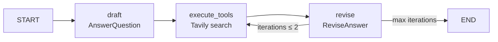
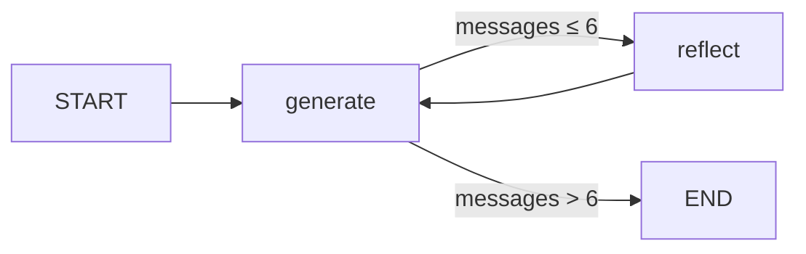

# AI Agents with LangGraph

Two LLM agents built with **LangGraph** that improve their own output through self-critique loops: a research agent that searches the web and cites its sources, and a reflection agent that iteratively refines a draft.

| Agent | Pattern | What it shows |
|---|---|---|
| [`tools-relfection-agent`](app/tools-relfection-agent) | **Reflexion** (draft → search → revise) | Structured outputs with Pydantic, tool calling, web search (Tavily), cited answers, bounded loop |
| [`reflection-agent`](app/reflection-agent) | **Reflection** (generate ↔ critique) | Custom graph state, conditional edges, local LLM (Ollama), tracing with LangSmith |

## 1. Research agent with tools (Reflexion)

Answers a research question, critiques its own answer, searches the web to fill the gaps, and rewrites the answer with numbered citations and references. Based on [Reflexion: Language Agents with Verbal Reinforcement Learning](https://openreview.net/pdf?id=vAElhFcKW6).



- **Structured output:** the LLM is forced to answer through Pydantic tool schemas: `AnswerQuestion` (answer + reflection on what is *missing* and *superfluous* + 1–3 search queries) and `ReviseAnswer` (adds references).
- **Tool use:** a LangGraph `ToolNode` runs the generated queries against Tavily (5 results per query).
- **Bounded loop:** at most 2 search → revise iterations to control cost and latency.
- **Verifiable answers:** the revision must stay under 300 words and include numbered citations plus a References section.

## 2. Reflection agent

Writes a LinkedIn post, then alternates between a *generator* and a *critic* (length, virality, style) until the conversation reaches 3 rounds.



- Custom `TypedDict` state with the `add_messages` reducer.
- Conditional edges to stop the loop.
- Runs on a **local LLM with Ollama**; traces in **LangSmith**.

## Tech stack
Python 3.12 · LangGraph · LangChain · Pydantic · Tavily · Ollama · OpenRouter · LangSmith · uv · Dev Containers

## Run it

Each agent is an independent `uv` project:

```bash
cd app/tools-relfection-agent   # or app/reflection-agent
uv sync
uv run python main.py
```

**Research agent `.env`:**
```env
OPENROUTER_MODEL=<model-id>
OPENROUTER_API_KEY=<your-key>
TAVILY_API_KEY=<your-key>
```

**Reflection agent `.env`:**
```env
OLLAMA_MODEL=<model>
OLLAMA_BASE_URL=http://localhost:11434
LANGSMITH_ENDPOINT=https://api.smith.langchain.com
LANGSMITH_API_KEY=<your-key>
```

A Dev Container (`.devcontainer/`) is included to run everything in Docker.

## Next steps
- Add tests for the routing logic (`should_continue`, `event_loop`) and evals for answer quality.
- Expose the research agent through a FastAPI endpoint.
